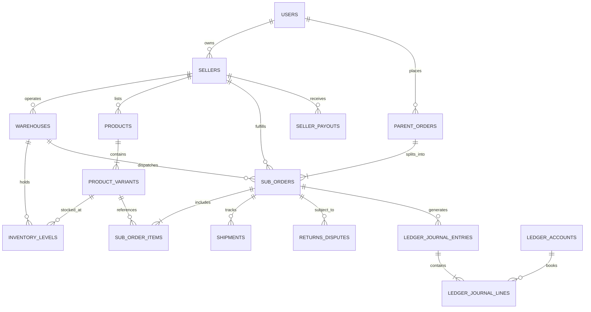

# Database Design Specification
## Enterprise International Multi-Vendor E-Commerce Platform

- **Document Version:** 1.0.0
- **Status:** Baseline Approved for Planning
- **Author:** Principal Software Architect & Database Engineer
- **Target RDBMS:** PostgreSQL 15+ with Drizzle ORM

---

## 1. Schema Overview & Architectural Principles

The database design addresses the omissions of typical simplistic marketplaces. It guarantees ACID consistency across split transactions, enforces non-negative inventory balances, preserves historical financial snapshots, and implements a true immutable **Double-Entry General Ledger**.

### Key Design Tenets:
1. **Financial Immutability:** Financial journals and ledger lines cannot be updated or deleted; corrective actions require counter-balancing entries.
2. **Deterministic Foreign Exchange:** Product variants store canonical prices in `USD`. All orders freeze the applied exchange rate and calculate exact local amounts at the moment of order placement.
3. **Itemized Cross-Border Splits:** Orders are modeled as a two-tier hierarchy (`parent_orders` and `sub_orders`) accompanied by explicit `sub_order_items` recording historical HS Codes, tariffs, and duty allocations.
4. **Tenant Isolation:** All vendor tables reference `seller_id` with foreign key indexes and strict query-level isolation.

---

## 2. Entity-Relationship Overview (Mermaid)



---

## 3. Detailed Table Specifications & DDL

### 3.1 Authentication, Users & Identity

```sql
-- 1. USERS
CREATE TYPE user_role AS ENUM ('customer', 'seller', 'super_admin');
CREATE TYPE user_status AS ENUM ('active', 'suspended', 'pending_verification');

CREATE TABLE users (
    id UUID PRIMARY KEY DEFAULT gen_random_uuid(),
    email VARCHAR(255) UNIQUE NOT NULL,
    password_hash VARCHAR(255) NOT NULL,
    full_name VARCHAR(150) NOT NULL,
    role user_role NOT NULL DEFAULT 'customer',
    status user_status NOT NULL DEFAULT 'active',
    phone_number VARCHAR(30),
    preferred_currency VARCHAR(3) DEFAULT 'USD',
    preferred_language VARCHAR(5) DEFAULT 'en',
    email_verified_at TIMESTAMPTZ,
    last_login_at TIMESTAMPTZ,
    created_at TIMESTAMPTZ NOT NULL DEFAULT NOW(),
    updated_at TIMESTAMPTZ NOT NULL DEFAULT NOW()
);

CREATE INDEX idx_users_email ON users(email);
CREATE INDEX idx_users_role ON users(role);
```

### 3.2 Regional Configuration & Currencies

```sql
-- 2. REGIONS & EXCHANGE RATES
CREATE TABLE regions (
    id UUID PRIMARY KEY DEFAULT gen_random_uuid(),
    code VARCHAR(10) UNIQUE NOT NULL, -- e.g., 'US', 'EU', 'GCC', 'PK', 'UK'
    name VARCHAR(100) NOT NULL,
    default_currency VARCHAR(3) NOT NULL, -- 'USD', 'EUR', 'AED', 'GBP'
    tax_engine VARCHAR(50) DEFAULT 'stripe_tax', -- 'stripe_tax', 'avalara', 'mock_tax'
    is_active BOOLEAN DEFAULT TRUE,
    created_at TIMESTAMPTZ NOT NULL DEFAULT NOW()
);

CREATE TABLE exchange_rates (
    id UUID PRIMARY KEY DEFAULT gen_random_uuid(),
    base_currency VARCHAR(3) NOT NULL DEFAULT 'USD',
    target_currency VARCHAR(3) NOT NULL,
    market_rate NUMERIC(14, 6) NOT NULL,
    buffer_percentage NUMERIC(5, 2) NOT NULL DEFAULT 1.50, -- 1.5% slippage buffer
    effective_rate NUMERIC(14, 6) GENERATED ALWAYS AS (market_rate * (1 + (buffer_percentage / 100.0))) STORED,
    updated_at TIMESTAMPTZ NOT NULL DEFAULT NOW(),
    CONSTRAINT uq_base_target_currency UNIQUE(base_currency, target_currency)
);

CREATE INDEX idx_exchange_rates_target ON exchange_rates(target_currency);
```

### 3.3 Sellers, KYC & Multi-Warehouses

```sql
-- 3. SELLERS & WAREHOUSES
CREATE TYPE kyc_status_enum AS ENUM ('pending', 'under_review', 'approved', 'rejected');

CREATE TABLE sellers (
    id UUID PRIMARY KEY DEFAULT gen_random_uuid(),
    user_id UUID NOT NULL UNIQUE REFERENCES users(id) ON DELETE CASCADE,
    business_name VARCHAR(255) NOT NULL,
    legal_entity_type VARCHAR(50) NOT NULL, -- 'individual', 'corporation', 'llc'
    tax_id_number VARCHAR(100) NOT NULL,
    country_code VARCHAR(2) NOT NULL, -- ISO 3166-1 alpha-2
    stripe_connected_account_id VARCHAR(255),
    wise_recipient_id VARCHAR(255),
    commission_rate NUMERIC(5, 2) NOT NULL DEFAULT 10.00, -- 10% platform take-rate
    rolling_reserve_rate NUMERIC(5, 2) NOT NULL DEFAULT 10.00, -- 10% held for chargeback risk
    rolling_reserve_days INT NOT NULL DEFAULT 60, -- 60-day hold
    escrow_inspection_days INT NOT NULL DEFAULT 14, -- 14-day return window post-delivery
    kyc_status kyc_status_enum NOT NULL DEFAULT 'pending',
    kyc_documents JSONB DEFAULT '[]'::jsonb, -- [{ "type": "passport", "url": "...", "verified": true }]
    payout_bank_details JSONB,
    created_at TIMESTAMPTZ NOT NULL DEFAULT NOW(),
    updated_at TIMESTAMPTZ NOT NULL DEFAULT NOW()
);

CREATE INDEX idx_sellers_user_id ON sellers(user_id);
CREATE INDEX idx_sellers_kyc_status ON sellers(kyc_status);

CREATE TABLE warehouses (
    id UUID PRIMARY KEY DEFAULT gen_random_uuid(),
    seller_id UUID NOT NULL REFERENCES sellers(id) ON DELETE CASCADE,
    warehouse_name VARCHAR(100) NOT NULL,
    country_code VARCHAR(2) NOT NULL, -- ISO-2 (Origin country for customs)
    state_province VARCHAR(100),
    city VARCHAR(100) NOT NULL,
    postal_code VARCHAR(20) NOT NULL,
    address_line_1 TEXT NOT NULL,
    address_line_2 TEXT,
    phone_contact VARCHAR(30),
    is_active BOOLEAN NOT NULL DEFAULT TRUE,
    created_at TIMESTAMPTZ NOT NULL DEFAULT NOW(),
    updated_at TIMESTAMPTZ NOT NULL DEFAULT NOW()
);

CREATE INDEX idx_warehouses_seller ON warehouses(seller_id);
CREATE INDEX idx_warehouses_country ON warehouses(country_code);
```

### 3.4 Catalog, Categories, Variants & HS Codes

```sql
-- 4. CATEGORIES, PRODUCTS & VARIANTS
CREATE TABLE categories (
    id UUID PRIMARY KEY DEFAULT gen_random_uuid(),
    parent_id UUID REFERENCES categories(id) ON DELETE SET NULL,
    slug VARCHAR(120) UNIQUE NOT NULL,
    name_i18n JSONB NOT NULL, -- {"en": "Electronics", "ar": "إلكترونيات"}
    hs_code_default VARCHAR(20),
    is_active BOOLEAN NOT NULL DEFAULT TRUE,
    created_at TIMESTAMPTZ NOT NULL DEFAULT NOW()
);

CREATE TYPE product_status_enum AS ENUM ('draft', 'pending_approval', 'active', 'archived');

CREATE TABLE products (
    id UUID PRIMARY KEY DEFAULT gen_random_uuid(),
    seller_id UUID NOT NULL REFERENCES sellers(id) ON DELETE CASCADE,
    category_id UUID NOT NULL REFERENCES categories(id),
    title_i18n JSONB NOT NULL, -- {"en": "...", "ar": "..."}
    description_i18n JSONB NOT NULL,
    brand VARCHAR(100),
    hs_code VARCHAR(20) NOT NULL, -- 6-10 digit HS Tariff Code
    origin_country VARCHAR(2) NOT NULL, -- ISO 3166-1 alpha-2
    status product_status_enum NOT NULL DEFAULT 'draft',
    images JSONB DEFAULT '[]'::jsonb, -- Array of CDN image URLs
    created_at TIMESTAMPTZ NOT NULL DEFAULT NOW(),
    updated_at TIMESTAMPTZ NOT NULL DEFAULT NOW()
);

CREATE INDEX idx_products_seller ON products(seller_id);
CREATE INDEX idx_products_category ON products(category_id);
CREATE INDEX idx_products_status ON products(status);
CREATE INDEX idx_products_hs_code ON products(hs_code);

CREATE TABLE product_variants (
    id UUID PRIMARY KEY DEFAULT gen_random_uuid(),
    product_id UUID NOT NULL REFERENCES products(id) ON DELETE CASCADE,
    sku VARCHAR(100) UNIQUE NOT NULL,
    title_i18n JSONB, -- Variant specific title if any
    attributes JSONB NOT NULL DEFAULT '{}'::jsonb, -- {"color": "Midnight Blue", "size": "XL"}
    weight_grams NUMERIC(10, 2) NOT NULL, -- Weight in grams
    length_cm NUMERIC(10, 2) NOT NULL,
    width_cm NUMERIC(10, 2) NOT NULL,
    height_cm NUMERIC(10, 2) NOT NULL,
    base_price_usd NUMERIC(12, 2) NOT NULL,
    created_at TIMESTAMPTZ NOT NULL DEFAULT NOW(),
    updated_at TIMESTAMPTZ NOT NULL DEFAULT NOW(),
    CONSTRAINT chk_positive_variant_price CHECK (base_price_usd > 0),
    CONSTRAINT chk_positive_dimensions CHECK (weight_grams > 0 AND length_cm > 0 AND width_cm > 0 AND height_cm > 0)
);

CREATE INDEX idx_product_variants_product ON product_variants(product_id);
CREATE INDEX idx_product_variants_sku ON product_variants(sku);
```

### 3.5 Real-Time Inventory & Stock Audit Log

```sql
-- 5. INVENTORY LEVELS & TRANSACTION AUDIT LOG
CREATE TABLE inventory_levels (
    id UUID PRIMARY KEY DEFAULT gen_random_uuid(),
    variant_id UUID NOT NULL REFERENCES product_variants(id) ON DELETE CASCADE,
    warehouse_id UUID NOT NULL REFERENCES warehouses(id) ON DELETE CASCADE,
    available_stock INT NOT NULL DEFAULT 0,
    reserved_stock INT NOT NULL DEFAULT 0,
    created_at TIMESTAMPTZ NOT NULL DEFAULT NOW(),
    updated_at TIMESTAMPTZ NOT NULL DEFAULT NOW(),
    CONSTRAINT uq_variant_warehouse UNIQUE (variant_id, warehouse_id),
    CONSTRAINT chk_positive_available_stock CHECK (available_stock >= 0),
    CONSTRAINT chk_positive_reserved_stock CHECK (reserved_stock >= 0)
);

CREATE INDEX idx_inventory_variant_warehouse ON inventory_levels(variant_id, warehouse_id);

CREATE TYPE inventory_movement_type AS ENUM (
    'stock_in', 'reservation_placed', 'reservation_released', 
    'reservation_fulfilled', 'adjustment', 'return_restock'
);

CREATE TABLE inventory_transactions (
    id UUID PRIMARY KEY DEFAULT gen_random_uuid(),
    variant_id UUID NOT NULL REFERENCES product_variants(id),
    warehouse_id UUID NOT NULL REFERENCES warehouses(id),
    movement_type inventory_movement_type NOT NULL,
    quantity_delta INT NOT NULL,
    reference_order_id UUID,
    reason TEXT,
    created_at TIMESTAMPTZ NOT NULL DEFAULT NOW()
);

CREATE INDEX idx_inv_tx_variant ON inventory_transactions(variant_id);
CREATE INDEX idx_inv_tx_order ON inventory_transactions(reference_order_id);
```

### 3.6 Parent Orders, Sub-Orders & Itemized Splits

```sql
-- 6. PARENT & SUB-ORDERS
CREATE TYPE payment_status_enum AS ENUM (
    'requires_payment', 'processing', 'captured', 
    'partially_refunded', 'refunded', 'failed'
);

CREATE TYPE sub_order_status_enum AS ENUM (
    'payment_pending', 'processing', 'manifested', 'shipped', 
    'customs_cleared', 'out_for_delivery', 'delivered', 
    'disputed', 'returned', 'cancelled'
);

CREATE TABLE parent_orders (
    id UUID PRIMARY KEY DEFAULT gen_random_uuid(),
    order_number VARCHAR(30) UNIQUE NOT NULL, -- e.g. 'PO-2026-1024-8901'
    customer_id UUID NOT NULL REFERENCES users(id),
    total_amount NUMERIC(12, 2) NOT NULL, -- Total in checkout currency
    currency VARCHAR(3) NOT NULL, -- e.g. 'EUR', 'USD', 'AED'
    exchange_rate_applied NUMERIC(14, 6) NOT NULL, -- Frozen rate from USD to checkout currency
    payment_intent_id VARCHAR(255) UNIQUE,
    payment_status payment_status_enum NOT NULL DEFAULT 'requires_payment',
    shipping_address JSONB NOT NULL,
    billing_address JSONB NOT NULL,
    created_at TIMESTAMPTZ NOT NULL DEFAULT NOW(),
    updated_at TIMESTAMPTZ NOT NULL DEFAULT NOW()
);

CREATE INDEX idx_parent_orders_customer ON parent_orders(customer_id);
CREATE INDEX idx_parent_orders_payment_intent ON parent_orders(payment_intent_id);

CREATE TABLE sub_orders (
    id UUID PRIMARY KEY DEFAULT gen_random_uuid(),
    sub_order_number VARCHAR(35) UNIQUE NOT NULL, -- e.g. 'SO-2026-1024-8901-01'
    parent_order_id UUID NOT NULL REFERENCES parent_orders(id) ON DELETE CASCADE,
    seller_id UUID NOT NULL REFERENCES sellers(id),
    warehouse_id UUID NOT NULL REFERENCES warehouses(id),
    items_subtotal NUMERIC(12, 2) NOT NULL,
    shipping_cost NUMERIC(12, 2) NOT NULL,
    customs_duties_amount NUMERIC(12, 2) NOT NULL DEFAULT 0.00,
    vat_gst_tax_amount NUMERIC(12, 2) NOT NULL DEFAULT 0.00,
    total_amount NUMERIC(12, 2) NOT NULL,
    carrier_name VARCHAR(50),
    carrier_tracking_code VARCHAR(255),
    carrier_label_url TEXT,
    commercial_invoice_url TEXT,
    order_status sub_order_status_enum NOT NULL DEFAULT 'payment_pending',
    inspection_expires_at TIMESTAMPTZ,
    delivered_at TIMESTAMPTZ,
    created_at TIMESTAMPTZ NOT NULL DEFAULT NOW(),
    updated_at TIMESTAMPTZ NOT NULL DEFAULT NOW()
);

CREATE INDEX idx_sub_orders_parent ON sub_orders(parent_order_id);
CREATE INDEX idx_sub_orders_seller ON sub_orders(seller_id);
CREATE INDEX idx_sub_orders_status ON sub_orders(order_status);

-- CRITICAL MISSING TABLE IN BASELINE SPEC: SUB-ORDER ITEMS
CREATE TABLE sub_order_items (
    id UUID PRIMARY KEY DEFAULT gen_random_uuid(),
    sub_order_id UUID NOT NULL REFERENCES sub_orders(id) ON DELETE CASCADE,
    variant_id UUID NOT NULL REFERENCES product_variants(id),
    sku VARCHAR(100) NOT NULL,
    product_title_snapshot VARCHAR(255) NOT NULL,
    quantity INT NOT NULL,
    unit_price_usd NUMERIC(12, 2) NOT NULL,
    unit_price_paid NUMERIC(12, 2) NOT NULL, -- In checkout currency
    total_line_amount NUMERIC(12, 2) NOT NULL,
    hs_code VARCHAR(20) NOT NULL,
    duty_rate_percentage NUMERIC(5, 2) NOT NULL DEFAULT 0.00,
    tax_rate_percentage NUMERIC(5, 2) NOT NULL DEFAULT 0.00,
    duty_amount NUMERIC(12, 2) NOT NULL DEFAULT 0.00,
    tax_amount NUMERIC(12, 2) NOT NULL DEFAULT 0.00,
    created_at TIMESTAMPTZ NOT NULL DEFAULT NOW(),
    CONSTRAINT chk_item_quantity CHECK (quantity > 0)
);

CREATE INDEX idx_sub_order_items_sub_order ON sub_order_items(sub_order_id);
CREATE INDEX idx_sub_order_items_variant ON sub_order_items(variant_id);
```

### 3.7 True Double-Entry Escrow General Ledger

```sql
-- 7. DOUBLE-ENTRY LEDGER & FINANCIAL SETTLEMENTS
CREATE TYPE account_type_enum AS ENUM ('asset', 'liability', 'equity', 'revenue', 'expense');

CREATE TABLE ledger_accounts (
    id UUID PRIMARY KEY DEFAULT gen_random_uuid(),
    account_number VARCHAR(20) UNIQUE NOT NULL, -- e.g. '1010', '2010', '4010'
    name VARCHAR(100) NOT NULL,
    type account_type_enum NOT NULL,
    currency VARCHAR(3) NOT NULL DEFAULT 'USD',
    description TEXT,
    is_active BOOLEAN NOT NULL DEFAULT TRUE,
    created_at TIMESTAMPTZ NOT NULL DEFAULT NOW()
);

-- Seed Default Platform Chart of Accounts:
-- 1010: Cash in Escrow (Asset)
-- 1020: Operating Cash / Bank (Asset)
-- 2010: Seller Payable Escrow (Liability)
-- 2020: Seller Rolling Reserve Held (Liability)
-- 2030: Tax Authority Payable (Liability)
-- 4010: Marketplace Commission Revenue (Revenue)
-- 5010: Payment Gateway Processing Fees (Expense)

CREATE TABLE ledger_journal_entries (
    id UUID PRIMARY KEY DEFAULT gen_random_uuid(),
    entry_number VARCHAR(40) UNIQUE NOT NULL, -- e.g. 'JE-2026-1024-00012'
    reference_type VARCHAR(50) NOT NULL, -- 'order_payment', 'escrow_release', 'refund', 'chargeback'
    reference_id UUID NOT NULL, -- sub_order_id, parent_order_id, refund_id
    description TEXT NOT NULL,
    posted_at TIMESTAMPTZ NOT NULL DEFAULT NOW(),
    created_at TIMESTAMPTZ NOT NULL DEFAULT NOW()
);

CREATE INDEX idx_journal_entries_ref ON ledger_journal_entries(reference_type, reference_id);

CREATE TABLE ledger_journal_lines (
    id UUID PRIMARY KEY DEFAULT gen_random_uuid(),
    journal_entry_id UUID NOT NULL REFERENCES ledger_journal_entries(id) ON DELETE RESTRICT,
    account_id UUID NOT NULL REFERENCES ledger_accounts(id) ON DELETE RESTRICT,
    seller_id UUID REFERENCES sellers(id), -- Nullable for platform accounts
    debit_amount NUMERIC(14, 4) NOT NULL DEFAULT 0.0000,
    credit_amount NUMERIC(14, 4) NOT NULL DEFAULT 0.0000,
    currency VARCHAR(3) NOT NULL DEFAULT 'USD',
    created_at TIMESTAMPTZ NOT NULL DEFAULT NOW(),
    CONSTRAINT chk_positive_debit CHECK (debit_amount >= 0),
    CONSTRAINT chk_positive_credit CHECK (credit_amount >= 0),
    CONSTRAINT chk_debit_or_credit CHECK (
        (debit_amount > 0 AND credit_amount = 0) OR 
        (credit_amount > 0 AND debit_amount = 0)
    )
);

CREATE INDEX idx_journal_lines_entry ON ledger_journal_lines(journal_entry_id);
CREATE INDEX idx_journal_lines_account ON ledger_journal_lines(account_id);
CREATE INDEX idx_journal_lines_seller ON ledger_journal_lines(seller_id);

-- Payout Disbursements Log
CREATE TYPE payout_status_enum AS ENUM ('scheduled', 'processing', 'completed', 'failed');

CREATE TABLE seller_payouts (
    id UUID PRIMARY KEY DEFAULT gen_random_uuid(),
    payout_batch_id VARCHAR(50),
    seller_id UUID NOT NULL REFERENCES sellers(id),
    amount NUMERIC(12, 2) NOT NULL,
    currency VARCHAR(3) NOT NULL, -- Localized payout currency
    provider VARCHAR(50) NOT NULL, -- 'wise', 'stripe_transfer', 'mock_payout'
    provider_transaction_id VARCHAR(255),
    status payout_status_enum NOT NULL DEFAULT 'scheduled',
    failure_reason TEXT,
    scheduled_for TIMESTAMPTZ NOT NULL,
    paid_at TIMESTAMPTZ,
    created_at TIMESTAMPTZ NOT NULL DEFAULT NOW(),
    updated_at TIMESTAMPTZ NOT NULL DEFAULT NOW()
);

CREATE INDEX idx_seller_payouts_seller ON seller_payouts(seller_id);
CREATE INDEX idx_seller_payouts_status ON seller_payouts(status);
```

### 3.8 Shipments, Customs Invoices & Webhook Events

```sql
-- 8. SHIPMENTS, COMMERCIAL INVOICES & IDEMPOTENCY
CREATE TABLE shipments (
    id UUID PRIMARY KEY DEFAULT gen_random_uuid(),
    sub_order_id UUID NOT NULL REFERENCES sub_orders(id) ON DELETE CASCADE,
    carrier VARCHAR(50) NOT NULL, -- 'DHL', 'FedEx', 'UPS', 'Aramex'
    tracking_number VARCHAR(100) NOT NULL,
    label_format VARCHAR(10) DEFAULT 'PDF',
    label_url TEXT NOT NULL,
    commercial_invoice_url TEXT NOT NULL,
    weight_kg NUMERIC(8, 3) NOT NULL,
    customs_declaration JSONB NOT NULL,
    current_status VARCHAR(50) NOT NULL DEFAULT 'manifested',
    shipped_at TIMESTAMPTZ,
    estimated_delivery TIMESTAMPTZ,
    actual_delivery TIMESTAMPTZ,
    created_at TIMESTAMPTZ NOT NULL DEFAULT NOW(),
    updated_at TIMESTAMPTZ NOT NULL DEFAULT NOW()
);

CREATE INDEX idx_shipments_tracking ON shipments(tracking_number);
CREATE INDEX idx_shipments_sub_order ON shipments(sub_order_id);

CREATE TABLE webhook_events (
    id UUID PRIMARY KEY DEFAULT gen_random_uuid(),
    source VARCHAR(50) NOT NULL, -- 'stripe', 'easypost', 'wise'
    event_id VARCHAR(255) NOT NULL, -- Unique event ID from provider
    event_type VARCHAR(100) NOT NULL,
    payload JSONB NOT NULL,
    status VARCHAR(30) NOT NULL DEFAULT 'pending', -- 'pending', 'processed', 'ignored', 'failed'
    error_message TEXT,
    received_at TIMESTAMPTZ NOT NULL DEFAULT NOW(),
    processed_at TIMESTAMPTZ,
    CONSTRAINT uq_webhook_source_event UNIQUE (source, event_id)
);

CREATE INDEX idx_webhook_status ON webhook_events(status);
```

---

## 4. Drizzle ORM Type-Safe Definitions Preview

```typescript
// packages/database/src/schema/orders.ts
import { pgTable, uuid, varchar, numeric, jsonb, timestamp, pgEnum } from 'drizzle-orm/pg-core';
import { users } from './users';
import { sellers, warehouses } from './sellers';
import { productVariants } from './products';

export const paymentStatusEnum = pgEnum('payment_status_enum', [
  'requires_payment', 'processing', 'captured', 'partially_refunded', 'refunded', 'failed'
]);

export const subOrderStatusEnum = pgEnum('sub_order_status_enum', [
  'payment_pending', 'processing', 'manifested', 'shipped', 
  'customs_cleared', 'out_for_delivery', 'delivered', 'disputed', 'returned', 'cancelled'
]);

export const parentOrders = pgTable('parent_orders', {
  id: uuid('id').defaultRandom().primaryKey(),
  orderNumber: varchar('order_number', { length: 30 }).unique().notNull(),
  customerId: uuid('customer_id').notNull().references(() => users.id),
  totalAmount: numeric('total_amount', { precision: 12, scale: 2 }).notNull(),
  currency: varchar('currency', { length: 3 }).notNull(),
  exchangeRateApplied: numeric('exchange_rate_applied', { precision: 14, scale: 6 }).notNull(),
  paymentIntentId: varchar('payment_intent_id', { length: 255 }).unique(),
  paymentStatus: paymentStatusEnum('payment_status').default('requires_payment').notNull(),
  shippingAddress: jsonb('shipping_address').notNull(),
  billingAddress: jsonb('billing_address').notNull(),
  createdAt: timestamp('created_at', { withTimezone: true }).defaultNow().notNull(),
  updatedAt: timestamp('updated_at', { withTimezone: true }).defaultNow().notNull(),
});
```

---

## 5. Invariants & Financial Integrity Guarantees

1. **Non-Negative Inventory Invariant:**
   Enforced via SQL check constraint: `CONSTRAINT chk_positive_available_stock CHECK (available_stock >= 0)`. Concurrency race conditions are handled by transaction isolation + Redis `SETNX` distributed locks.
2. **Double-Entry Zero Balance Invariant:**
   $$\sum_{line \in entry} \text{line.debit\_amount} = \sum_{line \in entry} \text{line.credit\_amount}$$
   Enforced by the ledger posting application service before transaction commit, with an immutable trigger validation.
3. **Immutable Auditing:**
   No `UPDATE` or `DELETE` grants on `ledger_journal_entries`, `ledger_journal_lines`, and `inventory_transactions`.
