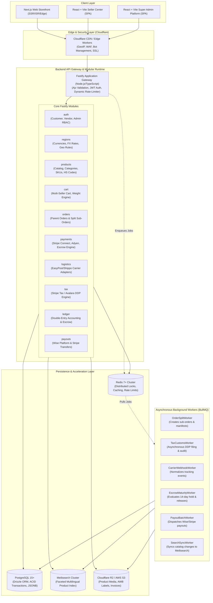
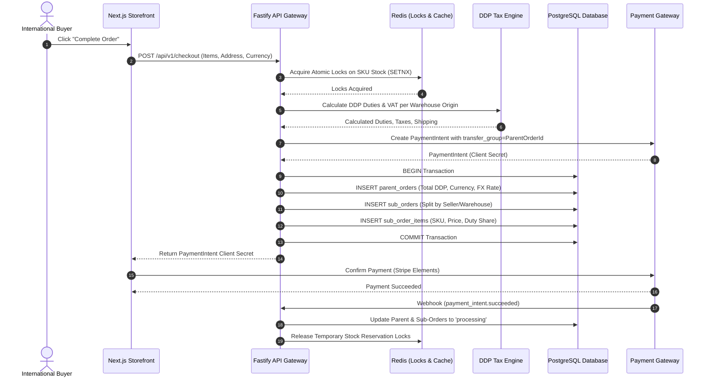
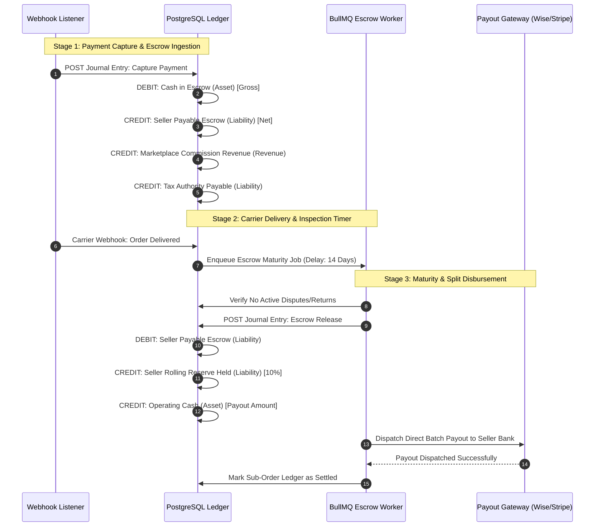
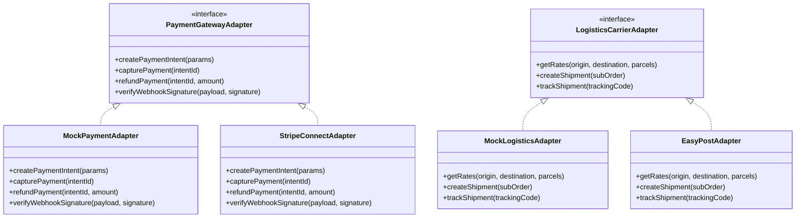

# System Architecture Document (SAD)
## Enterprise International Multi-Vendor E-Commerce Platform

- **Document Version:** 1.0.0
- **Status:** Baseline Approved for Planning
- **Author:** Principal Software Architect
- **Target Topology:** Monorepo (Turborepo), Modular Fastify Backend, Next.js Storefront, Vite SPAs, PostgreSQL, Redis, Meilisearch

---

## 1. High-Level Architecture Topology

The system is designed as a **Modular Monolith** engineered for high throughput, maintainability, and clean domain isolation. While deployed as cohesive services initially, each domain boundary maintains strict decoupling so that individual modules (e.g., checkout engine, ledger, search sync) can be extracted into independent microservices if traffic demands.



---

## 2. Monorepo Organization (Turborepo & pnpm)

The repository is structured as a unified monorepo governed by Turborepo to maximize code sharing, type consistency, and unified build pipelines.

```text
ecommerce-store/
├── apps/
│   ├── api/                          # Fastify Modular Backend API
│   │   ├── src/
│   │   │   ├── config/               # Zod validated env, CORS, security configs
│   │   │   ├── plugins/              # Fastify plugins (DB, Redis, JWT, OpenAPI)
│   │   │   ├── modules/              # Domain modules (auth, orders, ledger, etc.)
│   │   │   ├── adapters/             # External integration adapters (mock/live)
│   │   │   ├── workers/              # BullMQ queue processors
│   │   │   ├── app.ts                # App factory
│   │   │   └── server.ts             # Entrypoint & cluster lifecycle
│   │   ├── Dockerfile
│   │   └── package.json
│   ├── storefront/                   # Next.js 14+ App Router International Storefront
│   │   ├── src/
│   │   │   ├── app/                  # Localized route segments ([locale]/...)
│   │   │   ├── components/           # Feature-rich showcase UI components
│   │   │   ├── lib/                  # Client utilities, cart state, currency hooks
│   │   │   └── styles/               # Tailwind CSS & design tokens
│   │   ├── next.config.mjs
│   │   └── package.json
│   ├── seller-portal/                # React + Vite Seller Center SPA
│   │   ├── src/
│   │   │   ├── features/             # Onboarding, Inventory, Orders, Earnings
│   │   │   ├── components/           # Dense dashboard UI (Fira Code/Sans, Tables)
│   │   │   └── main.tsx
│   │   ├── vite.config.ts
│   │   └── package.json
│   └── admin-portal/                 # React + Vite Super Admin Management Console
│       ├── src/
│       │   ├── features/             # Seller KYC, Double-Entry Ledger, Disputes
│       │   ├── components/           # High-density operational data tables
│       │   └── main.tsx
│       ├── vite.config.ts
│       └── package.json
├── packages/
│   ├── database/                     # PostgreSQL schema & Drizzle ORM definitions
│   │   ├── src/
│   │   │   ├── schema/               # Modular Drizzle schemas
│   │   │   ├── migrations/           # Versioned SQL migration scripts
│   │   │   ├── seed/                 # Initial system seed data
│   │   │   └── index.ts              # Client instance exporter
│   │   └── package.json
│   ├── shared-types/                 # Universal TypeScript interfaces & DTOs
│   │   ├── src/
│   │   │   ├── catalog.ts
│   │   │   ├── orders.ts
│   │   │   ├── ledger.ts
│   │   │   ├── api-contracts.ts
│   │   │   └── index.ts
│   │   └── package.json
│   ├── design-tokens/                # Master UI tokens (CSS vars, colors, typography)
│   │   ├── src/
│   │   │   ├── tokens.json
│   │   │   └── index.ts
│   │   └── package.json
│   ├── eslint-config/                # Shared ESLint configurations
│   └── tsconfig/                     # Shared TypeScript base configs
├── docs/                             # Architecture, API, and System Specifications
├── turbo.json                        # Turborepo task orchestrator
├── pnpm-workspace.yaml               # Monorepo workspace configuration
└── package.json                      # Root scripts and dev dependencies
```

---

## 3. Subsystem Breakdown & Architecture Patterns

### 3.1 Modular API Gateway (Fastify)
- **Plugin Architecture:** Utilizes Fastify's encapsulated plugin hierarchy. Plugins handle infrastructure hooks (`@fastify/sensible`, `@fastify/cors`, `@fastify/rate-limit`, `@fastify/jwt`, `@fastify/swagger`).
- **Validation Engine:** All endpoints enforce strict request/response schemas compiled using **Ajv (Another JSON Schema Validator)**, ensuring deterministic payload serialization and high throughput.
- **Error Handling:** Standardized RFC 7807 Problem Details formatting across all failure domains (400 Bad Request, 401 Unauthorized, 403 Forbidden, 409 Conflict, 422 Unprocessable, 500 Internal).

### 3.2 Dynamic Regional & Multi-Currency Engine
- **Base Currency:** All catalog product variants store prices natively in **USD** (`base_price_usd`).
- **FX Rates & Buffer:** Exchange rates are stored in `exchange_rates` and cached in Redis. A configurable markup buffer (1.5% to 2.0%) is injected into all customer-facing rate conversions:
  $$\text{Effective Rate}(\text{USD} \rightarrow \text{Target}) = \text{Market Rate} \times (1 + \text{Buffer})$$
- **Rate Locking:** When an order is created, the applied exchange rate is frozen in `parent_orders.exchange_rate_applied`, preventing retrospective currency exposure.

### 3.3 Atomic Inventory & Distributed Reservation
- **Concurrency Guard:** To eliminate race conditions during high-demand traffic spikes, checkout requests request an atomic reservation via Redis:
  ```text
  Key: stock:lock:{variant_id}:{warehouse_id}
  Command: SET stock:lock:{variant_id}:{warehouse_id} {checkout_id} NX EX 900
  ```
- **PostgreSQL Atomicity:** When the reservation completes, the database decrements `available_stock` and increments `reserved_stock` inside an isolated transaction with a database-level `CHECK (available_stock >= 0)`.
- **TTL Expiration:** If the customer abandons checkout, a BullMQ delayed job triggers after 15 minutes to release the reserved stock.

### 3.4 Multi-Seller Split-Order Engine
- A customer submits a single checkout payload containing items from multiple distinct sellers and warehouses.
- The checkout pipeline performs:
  1. Validation of stock reservations.
  2. Valuation of DDP customs duties and shipping per seller warehouse.
  3. Generation of a **Parent Order** representing the customer invoice and single payment capture.
  4. Instant creation of $N$ **Child Sub-Orders** partitioned by `(seller_id, warehouse_id)`.
  5. Insertion of itemized `sub_order_items`.



### 3.5 Double-Entry Accounting & Escrow Settlement Engine
- Rather than maintaining vulnerable running balance counters, all marketplace financial movements are managed via an immutable **Double-Entry General Ledger**.
- Every transaction creates a balanced `ledger_journal_entry` containing at least two `ledger_journal_lines` where $\sum \text{Debit} == \sum \text{Credit}$.



---

## 4. Integration Adapter Architecture (Anti-Corruption Layer)

To maintain absolute independence from vendor-specific APIs and satisfy enterprise testing standards, all third-party systems are integrated through an **Adapter Interface Pattern**:



All local development, unit testing, and initial staging environments operate against Mock Adapters, ensuring deterministic testing without incurring live transaction charges or relying on live external sandboxes. Production switches to live adapters purely through environment configuration flags.

---

## 5. Security & Isolation Boundaries

1. **Strict Tenant Segregation:**
   - Every vendor query enforces an explicit `WHERE seller_id = :authenticated_seller_id` clause.
   - Database foreign keys enforce cascading referential integrity.
2. **Stateless JWT with Fast Invalidation:**
   - JWT tokens carry user role (`customer`, `seller`, `super_admin`) and tenant claims.
   - Token blocklist / revocation managed via Redis cluster for immediate logout capability.
3. **Idempotency Barrier:**
   - Every transactional API call (checkout, payment capture, refund, settlement release) mandates an `Idempotency-Key` HTTP header stored in Redis to guarantee single execution under network retries.
